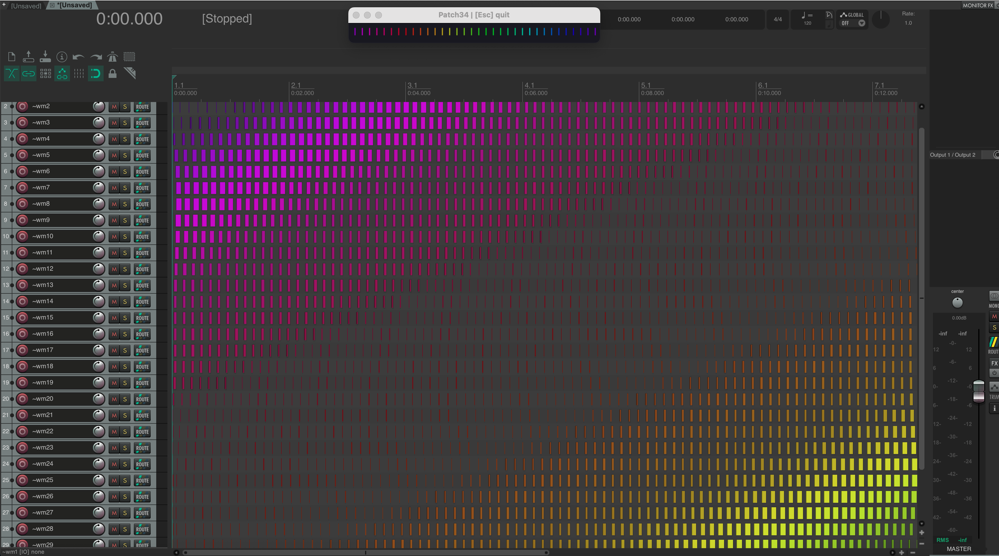

# Patch34: REAPER Timeline Screensaver

A REAPER screensaver script. Media items across a large grid physically move and change color in real time, forming animated diagonal wave patterns. Absolutely without any practical usage.

## What it does

The script creates a new project tab with a 120 × 30 grid of media items — 3 600 items in total. Every frame, each item's position, length, and color are recalculated from a sine-wave formula and written directly to the REAPER timeline via the API. The result is a diagonal traveling wave that ripples across the arrange view like a snake pattern.

A small GFX window shows the current mode name in animated rainbow lettering.

---

## Requirements

- REAPER 6 or later
- No external plugins or dependencies required

---

## Installation

1. Copy `Patch34_REAPER_Timeline_Screensaver.lua` to your REAPER scripts folder:
   - macOS: `~/Library/Application Support/REAPER/Scripts/`
   - Windows: `%APPDATA%\REAPER\Scripts\`
2. In REAPER: **Actions → Load ReaScript** → select the file
3. Run the action

---

## Usage

| Key | Action |
|-----|--------|
| `Esc` | Quit the screensaver and close the project tab |

The script opens in a **new project tab** so your current project is not affected. On exit it automatically closes that tab and returns you to the previous one.

---

  

## Configuration

All parameters are defined as constants at the top of the script:

| Constant | Default | Description |
|----------|---------|-------------|
| `GRID_W` | 120 | Number of items per track (columns) |
| `GRID_H` | 30 | Number of tracks (rows) |
| `CELL_WIDTH` | 0.15 | Spacing between item positions (seconds) |
| `BASE_LENGTH` | 0.12 | Base item length before wave scaling (seconds) |
| `VISIBLE_W` | 80 | Columns visible in the initial zoom |
| `FPS_TARGET` | 20 | Target frames per second |
| `SPEED` | 1.5 | Animation speed multiplier |
| `TRACK_HEIGHT` | 16 | Track height in pixels |

Reducing `GRID_W` and `GRID_H` significantly improves performance on slower machines.

---

## Performance notes

At default settings the script modifies up to **10 800 item properties per frame** (3 600 items × position + length + color). A delta check is applied before each write — properties are only updated if the new value differs from the previous one by more than a small threshold, which reduces the number of actual API calls on most frames.

If the animation stutters, try:
- Lowering `FPS_TARGET` to 10–15
- Reducing `GRID_W` to 60 and `GRID_H` to 20
- Closing other CPU-intensive processes

---

## License

MIT — do whatever you want with it.
