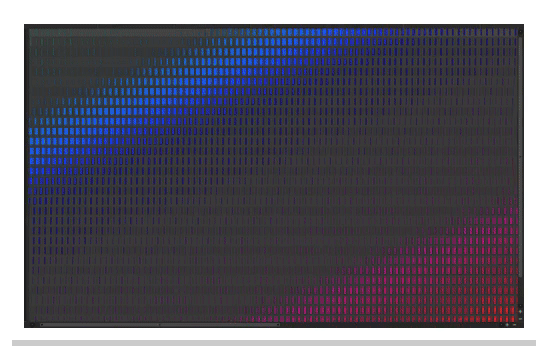
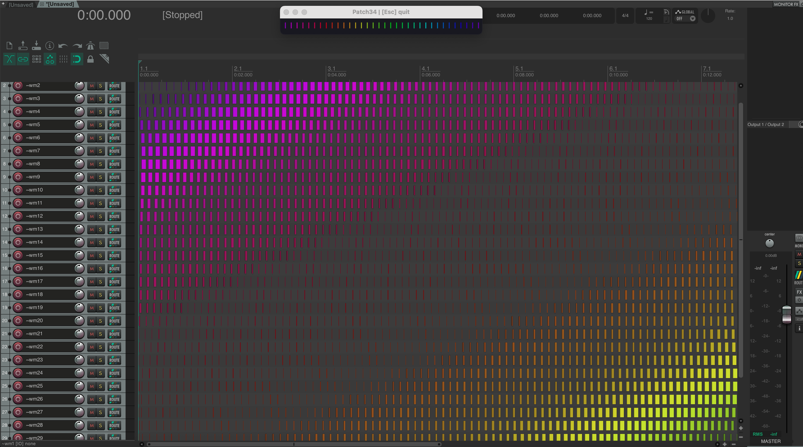

# REAPER Timeline Screensaver

[English](README.md) · **Русский**

Создаёт анимацию из медиаэлементов в отдельной вкладке проекта REAPER.

## Описание и параметры

- По умолчанию скрипт создаёт сетку из 120 × 30 медиаэлементов (всего 3600), распределённых по трекам.
- Каждое обновление меняет их позиции, длины и цвета, создавая диагональные волны.
- При нажатии **Esc** в активном окне анимации скрипт завершает работу и закрывает созданную вкладку проекта.
- Для уменьшения нагрузки используйте параметры `GRID_W`, `GRID_H` и `FPS_TARGET` в начале Lua-файла.

## Требования

REAPER 6 или новее. Сторонние расширения не требуются.

## Установка

### Через ReaPack

Добавьте [каталог Patch34 ReaPack](https://raw.githubusercontent.com/patch-34/patch34-reapack/main/index.xml) через **Extensions → ReaPack → Import repositories…**, затем найдите **REAPER Timeline Screensaver** в **Browse packages** и установите пакет.

### Вручную

1. Скопируйте `REAPER_Timeline_Screensaver.lua` в каталог `Scripts` ресурсов REAPER.
2. Откройте **Actions → Show action list → New action → Load ReaScript** и выберите Lua-файл.
3. Запустите действие или назначьте сочетание клавиш.

## Лицензия и авторство

Распространяется по [лицензии MIT](LICENSE).

Автор: [Aleksei Vorobev / Patch34](https://github.com/patch-34).
